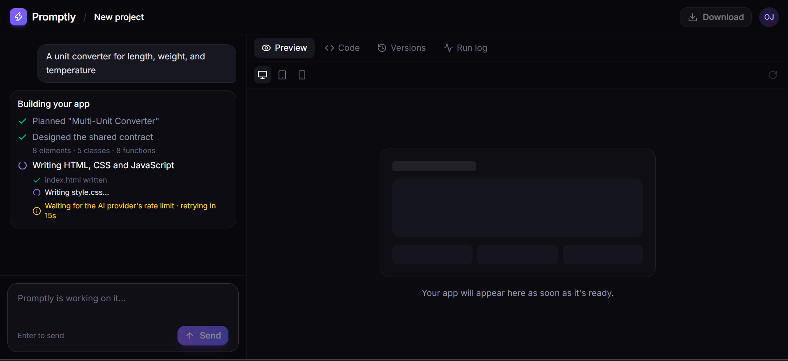
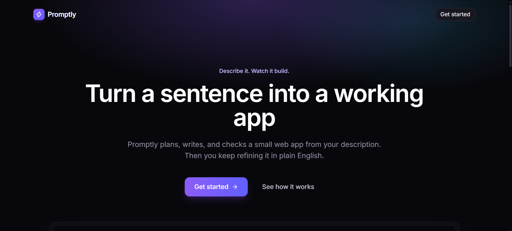
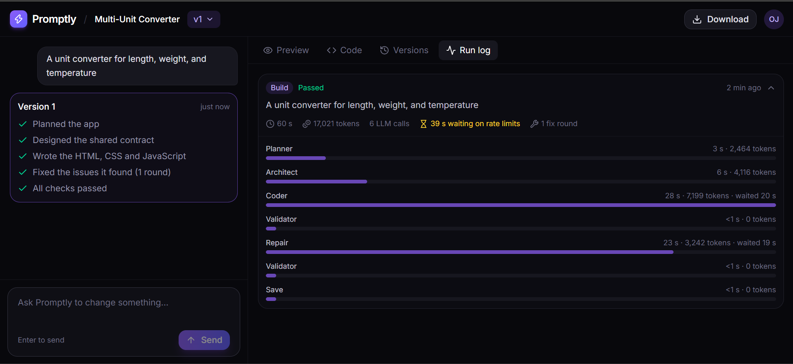
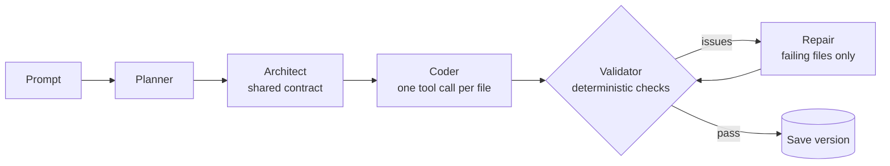
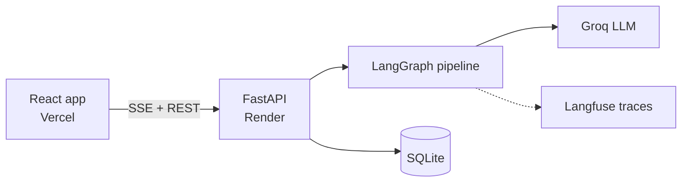

# Promptly

**Describe an app in plain English. Promptly plans it, writes it, checks its own work, and lets you keep refining it.**

[Live demo](<https://promptly-two-delta.vercel.app/>) · [Demo video](<https://youtu.be/1Iby48S8OxE?si=o052YNNCtC4ydbzI>) · [Evaluation report](backend/evals/results/report.md)





Promptly is a multi-agent text-to-app system. You describe a small web app, and a pipeline of specialised agents produces working HTML, CSS and JavaScript, validates it with deterministic checks, repairs what fails, and streams the whole process to a live workspace. Follow-up requests ("make the buttons orange") become new versions you can compare and restore.

It runs on Groq's free tier, so most of the engineering here is about making an unreliable, rate-limited model behave like a dependable product.

## What you can do

- **Build** a small web app from one sentence and watch each stage and each file appear live.
- **Refine** it in chat. Each change creates a new version, and any earlier version can be restored.
- **Preview** on desktop, tablet and mobile widths, read the **code** with syntax highlighting, or **download** the files as a zip.
- **Inspect every run** in the Run log tab: time, tokens, LLM calls, rate-limit waiting and fix rounds, broken down by step.

## How it works



1. **Planner** turns the request into a validated plan (features, style, scope). Out-of-scope requests are redirected to the closest browser-only app, with an explanation.
2. **Architect** writes a *contract*: the element IDs, CSS classes and JavaScript functions that all three files must share, plus a task for each file.
3. **Coder** writes each file through a forced `write_file` tool call. CSS and JavaScript are shown the real HTML that was already written.
4. **Validator** checks the output with plain code: no model involved.
5. **Repair** regenerates only the files with issues, passing the exact problems back to the model. It is capped at two rounds and an overall deadline.
6. The result is saved as a new version, and every step streams to the browser.



## Engineering highlights

1. **A contract between files, not just three prompts.** Separate calls can't see each other, so they drift: one file names a button `equals-btn`, another looks for `equalsButton`. The Architect's contract, enforced by Pydantic patterns and cross-field checks, is the shared agreement all three files must keep.
2. **A deterministic validator instead of an LLM judge.** It checks that every contract ID exists exactly once, JavaScript functions are defined, every ID the script looks up exists in the HTML, no network APIs (`fetch`, `XMLHttpRequest`, `WebSocket`, `eval`, `new Function`) or external URLs appear in any file, no placeholder text like "rest of the code", and the files link to each other. Scope rules are enforced on the generated files, which are facts, instead of the plan, which is only an intention. All issues are reported at once, so one repair round can fix them all.
3. **Bounded loops everywhere.** Output retries, repair rounds, transport retries and the overall build deadline all have hard caps, and the worst-case number of API calls is documented in the code.
4. **A reliability layer for a rate-limited API.** Errors are typed with a `retryable` flag. The retry loop honours the provider's `Retry-After` hint (capped, so a daily limit fails fast), the SDK's own retries are disabled to avoid multiplying attempts, and tests drive the whole stack with a fake client.
5. **Real-time UX on a slow, throttled backend.** Server-Sent Events stream steps, per-file progress and a live "retrying in 14s" countdown, with a heartbeat so long builds never drop. The build runs on its own thread, so it finishes and saves even if you close the tab.
6. **Defence in depth for untrusted code.** The Coder can only write one locked filename, and a path guard rejects traversal and oversized content. Previews are served with `Content-Security-Policy: connect-src 'none'` inside a sandboxed, cross-origin iframe. Tokens are stored as SHA-256 hashes, every project is scoped to its owner, and daily quotas protect the AI budget.
7. **Observed and evaluated, not assumed.** Every build records a run log, and every LLM call is traced in Langfuse. An evaluation harness runs the real pipeline against a fixed prompt set and reports pass rates, repairs, tokens and where time goes.

## Evaluation

The evaluation harness (`backend/evals`) tests Promptly against 16 prompts covering utilities, productivity apps, games, websites, interactive applications, a data dashboard, an out-of-scope request, and a prompt-injection attempt.

It measures validation pass rate, first-attempt success, repair rounds, token usage, build time, and validator issues.

**Latest evaluation (16 prompts, `openai/gpt-oss-120b` on Groq's free tier):**

| Metric | Result |
|---|---:|
| Builds that passed validation | **15 / 16 (94%)** |
| Passed without repairs | 10 / 16 (62%) |
| Average fix rounds per build | 0.31 |
| Median build time | 99.5 s |
| Median tokens per build | 13,374 |
| Total tokens | 208,722 |
| Time spent waiting on rate limits | 79% |
| Out-of-scope requests redirected | 0 / 1 |

**What the evaluation found**

15 of 16 builds passed validation. The five first-attempt validator issues were:

- `missing_css_selector`: 2 occurrences
- `missing_class`: 2 occurrences
- `forbidden_api`: 1 occurrence

The repair loop successfully resolved these issues. The only failed prompt was `fastapi-request`, where the Planner generated a `scope_note` exceeding the schema's 240-character limit.

The results demonstrate that Promptly can generate and validate a variety of applications, while highlighting an area for improvement: enforcing structured output constraints at the planning stage.

**Performance note:** Build time is heavily affected by Groq's free-tier rate limits, which accounted for 79% of total evaluation time.

## Tech stack

| Layer | Choice |
|---|---|
| Orchestration | LangGraph |
| Backend | FastAPI, Pydantic, SQLite |
| Model | Groq (`openai/gpt-oss-120b`), forced tool calling |
| Streaming | Server-Sent Events |
| Observability | Run log in SQLite, Langfuse tracing |
| Frontend | React, TypeScript, Vite, Tailwind CSS v4 |
| Hosting | Render (API), Vercel (web) |
| Testing | pytest, 200+ tests, fake model clients, no network |

## API

| Endpoint | Purpose |
|---|---|
| `POST /api/users` | Create a profile and receive a token |
| `POST /api/builds/stream` | Build an app (SSE stream) |
| `POST /api/projects/{id}/edits/stream` | Apply a change (SSE stream) |
| `GET /api/projects` | List your projects |
| `GET /api/projects/{id}/versions/{n}` | Files, plan and contract for a version |
| `POST /api/projects/{id}/versions/{n}/restore` | Restore a version as a new one |
| `GET /api/projects/{id}/runs` | The run log |
| `GET /api/projects/{id}/versions/{n}/files/{file}` | Preview file (public by link) |

## Project structure

```
backend/
  app/
    agents/      planner, architect, coder, validator, editor, graph, prompts/
    api/         auth, builds (SSE), projects
    db/          SQLite schema and repository
    schemas/     Pydantic models: plan, architecture (the contract), edit plan
    services/    llm client, retry, progress events, tracing, run-log summaries
    tools/       the sandboxed write_file tool
  evals/         prompt set, runner, report
  tests/
frontend/
  src/
    pages/       landing, get started, home, workspace
    components/  ui kit and workspace (chat, preview, code, versions, run log)
    lib/         API client, SSE hook, workspace state
```

## Run it locally

You need Python 3.10+, Node 20+ and a free [Groq API key](https://console.groq.com).

```bash
# from the repository root
python -m venv venv
venv\Scripts\activate                  # macOS/Linux: source venv/bin/activate
pip install -r backend/requirements.txt
cp .env.example .env                   # add your GROQ_API_KEY
cd backend
uvicorn app.main:app --reload --port 8000
```

```bash
# in a second terminal
cd frontend
npm install
echo VITE_API_URL=http://localhost:8000 > .env
npm run dev                            # http://localhost:5173
```

| Variable | Purpose |
|---|---|
| `GROQ_API_KEY` | Required |
| `GROQ_MODEL` | Model name |
| `ALLOWED_ORIGINS` | Comma-separated web origins allowed by CORS |
| `DAILY_RUN_LIMIT_PER_USER`, `DAILY_RUN_LIMIT_TOTAL` | Daily quotas (defaults 5 and 60) |
| `LANGFUSE_PUBLIC_KEY`, `LANGFUSE_SECRET_KEY`, `LANGFUSE_HOST` | Optional tracing |

```bash
cd backend
python -m pytest                       # unit and integration tests, no network
python -m evals.run_evals --limit 2    # smoke-test the real pipeline
```

## Deployment

The API runs on Render (root directory `backend`, start command `uvicorn app.main:app --host 0.0.0.0 --port $PORT`) and the web app on Vercel (root directory `frontend`, `VITE_API_URL` pointing at the API). Set `ALLOWED_ORIGINS` on the API to the Vercel URL.

## Limitations and trade-offs

- **Demo data resets.** SQLite on a free Render instance is ephemeral, so projects are lost when the service sleeps or redeploys. A persistent disk or hosted Postgres would fix this.
- **No account recovery.** Identity is a device token, so history lives in one browser. Magic-link sign-in is the natural next step.
- **The validator uses regex for JavaScript**, which can be fooled by comments and strings. It checks structure and scope, not behaviour. The optional browser check catches runtime errors, but nothing here proves an app does what you asked.
- **Free-tier throughput.** One build runs at a time and users are capped daily. Builds take around a minute because of the provider's rate limit.
- **Small apps only.** Three files of plain HTML, CSS and JavaScript, with no backend or external services.

## Roadmap

Hosted Postgres, magic-link sign-in, reconnecting to a build in progress, a real JavaScript syntax check, side-by-side version diffs, and a model comparison on the evaluation set.

## Author

Built by **John Confidence Bello** · [LinkedIn](<https://www.linkedin.com/in/john-confidence-bello-/>) · [GitHub](<https://github.com/JohnConfidence556>)